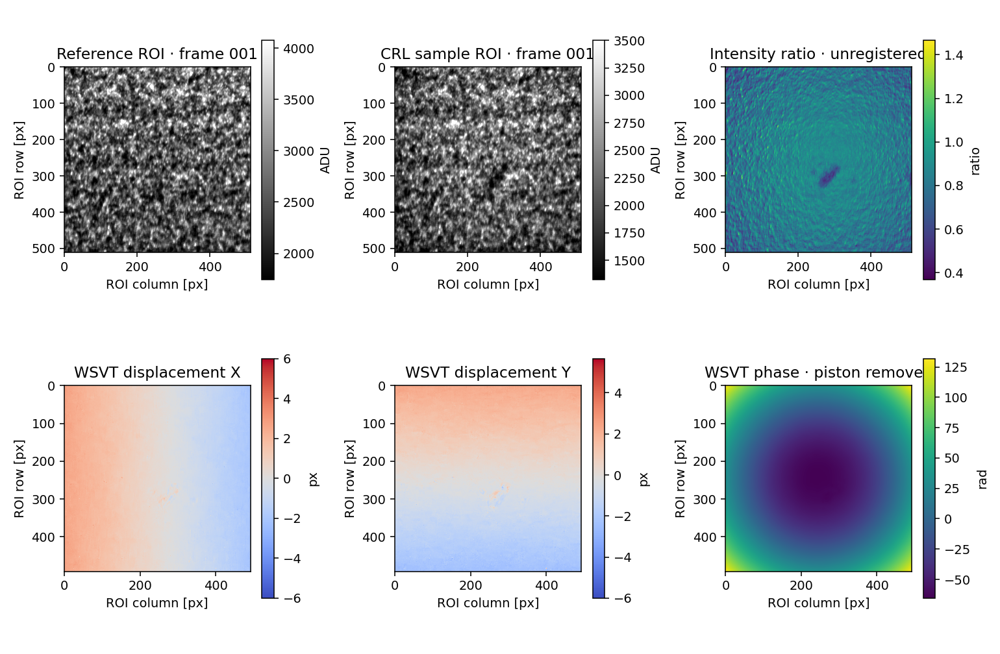

# Wavefront Starter · X 射线波前传感

**从基础概念到跑通真实数据。** 面向刚开始做 X 射线波前传感的同学，提供中文操作指南、文献导读、真实 CRL 散斑案例和四个独立工具界面。

[下载 Windows 完整包](https://github.com/haohaoxueyangwen/wavefront-starter/releases/latest) · [全部文档](docs/README.md) · [重要综述](docs/05_key_reviews.md) · [反馈问题](https://github.com/haohaoxueyangwen/wavefront-starter/issues/new/choose)

## 第一次用：下载 → 解压 → 跑 CRL

1. 在 [最新发布页](https://github.com/haohaoxueyangwen/wavefront-starter/releases/latest)下载 **`wavefront-starter-0.6.4-windows-x64.zip`**，右键“全部解压”。名字带 `windows-x64` 才是完整运行包；GitHub 的 `Source code` 是开发源码。
2. 双击 **`start_speckle.cmd`**，选择 **WXST → C++ CPU → 载入 CRL 实测示例 → 运行算法**。
3. 查看位移、偏折角和相位，在“数据文件与本次配置”保存数值结果和参数。接着换成 WSVT，再载入示例，用全部100对扫描帧重建。

完整包内含 Python、依赖、CPU / GPU 程序和示例数据，可以离线跑例子。无需安装 Anaconda、编译程序或安装 CUDA Toolkit。不知道电脑配置，先用 CPU；NVIDIA GPU 是否可用由界面检测。具体电脑要求见 [Windows 指南](docs/12_windows_quickstart.md)。



这是 BB11 **金刚石 CRL 真实实验数据**：100对2048²原图的512²中央裁剪，保留 uint16 原像素值。上排灰度比仅供观察；下排为 CPU WSVT 重建。数据来源、裁剪位置和标定见 [CRL 案例](docs/14_crl_example.md)。

继续做 Zernike：点击结果中的 **“Zernike 分解 →”**，核对自动带入的 **12.4 keV / 1.625 µm**，预览、拖画圆瞳、运行。相位、来源和成功结果中的能量 / 像元会带入；自己导入的相位需按实验填写标定。输出为492²，圆瞳坐标按输出图确定。详细步骤见 [波前 / Zernike 操作](docs/17_wavefront_workflow.md)。

## 按方法打开工具

四个界面分别使用，文件与文件夹通过“浏览…”选择。一次只运行一个任务，结果另存到新目录。

| 工具 | 双击入口 | 直接提供的功能 | 操作指南 |
|---|---|---|---|
| 散斑 WSVT / WXST | `start_speckle.cmd` | 单对空间模板 / 多帧时间向量；C++ CPU、原生 CUDA GPU、Python 参考；完整参数 | [Windows 入门](docs/12_windows_quickstart.md)、[全参数](docs/11_speckle_fast.md) |
| 光栅 | `start_grating.cmd` | FFT 边带选择、相位展开、差分条纹相位、显式标定后的梯度积分 | [光栅逐步操作](docs/15_grating_workflow.md) |
| Hartmann | `start_hartmann.cmd` | 固定网格质心、参考 / 样品质心位移、标定后的偏折角 | [Hartmann 逐步操作](docs/16_hartmann_workflow.md) |
| 波前 / Zernike | `start_wavefront.cmd` | 手动圆瞳、5–50项、径向阶数去除、PV / RMS、曲率、完整报告和数值导出 | [波前分析逐步操作](docs/17_wavefront_workflow.md)、[原功能对照](docs/10_zernike_parity.md) |

Hartmann 设计 / 动态仿真 / 旋转试验，以及自动 ROI 曲率 / 残差、焦点扫描，是需要原研究工程与附加依赖的扩展。完整手动 Zernike 已随包提供。各入口边界见 [界面总览](docs/08_interfaces.md)。

## 学习与日常使用

| 你的目标 | 阅读路径 |
|---|---|
| 建立物理概念 | [方法与物理量](docs/03_methods.md) → [分阶段学习路线](docs/06_learning_path.md) |
| 先读综述，再选研究方向 | [7篇重点综述与理论总览](docs/05_key_reviews.md) → [34条分类文献与专著](docs/04_reading.md) |
| 导入文献管理软件 | [BibTeX / RIS 与文献索引](literature/README.md) |
| 换自己的实验数据 | [坐标、单位、配对与标定](docs/02_real_data.md) → [八种配置模板](examples/README.md) |
| 保存结果、复跑、换电脑或升级 | [结果与排错指南](docs/18_results_and_faq.md) |
| 查软件、公开数据和原研究工程 | [资源导航](docs/07_resources.md) |
| 修改代码、构建与发布 | [开发与发布](docs/19_development.md) → [贡献说明](CONTRIBUTING.md) |

文献共34条，含10条综述、综述型研究论文或理论总览；元数据于2026-10-12复查。文献导读给出阅读目的与方法关联，全文通过出版社、作者机构库或预印本入口取得。[全部文档目录](docs/README.md)同时列出操作、示例、来源和验证记录。

## 支持与验证范围

Windows 完整包面向 Windows 10/11 x64 的 Intel / AMD CPU。CUDA 后端需要兼容 NVIDIA 显卡与驱动；Windows 实测设备为 Quadro P5000。Linux 原生构建和 Ada / Orin 历史结果见 [高速散斑指南](docs/11_speckle_fast.md)。macOS、Windows ARM 没有本包原生二进制验收。

CRL 的 CPU / GPU 对照说明本数据上的执行与实现一致性；真实透镜没有已知逐像素位移真值。光栅、Hartmann、Zernike 的独立解析控制另有明确答案。设备、数值指标和已知限制见 [Windows 验证说明](docs/13_windows_validation.md)。v0.6.4 完善主页与操作文档，算法、Windows运行库和CRL数据沿用 v0.6.1。

## 从源码安装

开发者使用 Python 3.11–3.12 与独立环境。以下为 Windows PowerShell 命令：

```powershell
git clone https://github.com/haohaoxueyangwen/wavefront-starter.git
cd wavefront-starter
py -3.12 -m venv .venv
.\.venv\Scripts\python.exe -m pip install -r requirements-lock.txt
.\.venv\Scripts\python.exe -m pip install --no-deps --no-build-isolation -e .
.\.venv\Scripts\python.exe -m wfs_starter check-env
.\.venv\Scripts\python.exe -m wfs_starter ui --app speckle
```

**源码不附带 Windows 运行库，也不会自动编译原生算法。** 源码环境可运行 Python 参考算法，CRL 首次载入需联网下载并校验约79 MiB数据。Linux/macOS 安装路径、命令行复跑及原生构建见 [开发指南](docs/19_development.md)。

## 来源与维护

本仓库维护教学入口、独立界面、配置与可追溯的算法桥接。高性能散斑算法在 [WSVT_CPP](https://github.com/haohaoxueyangwen/WSVT_CPP)分别维护，完整 Hartmann 研究工程在 [hartmann_V2](https://github.com/haohaoxueyangwen/hartmann_V2)维护。日常修改位置见 [代码维护](docs/09_code_maintenance.md)，版本变化见 [CHANGELOG](CHANGELOG.md)。

散斑参考实现保留 UChicago Argonne 版权声明，第三方组件遵循各自许可证；本仓库没有另授予覆盖全部组件的统一新许可证。来源与组件说明见 [NOTICE](provenance/NOTICE.md)。运行包只含明确选取的 CRL 裁剪示例，不含其他实验数据、实验本、本机配置或运行历史。

[首次下载与四工具复核](docs/20_first_use_validation.md)：按初学者流程验证下载、浏览数据、运行、导出和重启记录。
