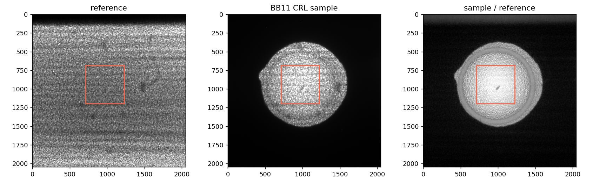

# 用真正的 CRL 透镜数据跑第一遍

默认散斑示例现在采用 **2023-11-02 的 BB11 金刚石 CRL 实测数据**。实验本记录名义曲率半径 **500 μm**；没有另造散斑图，也没有给图像人为添加位移。

红框是实际分发的中央区域，原始透镜全景供理解裁剪位置。

图中前两幅是第 001 对实际参考 / 样品图。灰度比仅用于观察透射变化，未做配准，不能直接当作透射率真值；下排是随包 CPU WSVT 对 100 对扫描帧的重建，单位分别为 px、px、rad。

## 直接操作

1. 从 [v0.6.2 发布页](https://github.com/haohaoxueyangwen/wavefront-starter/releases/tag/v0.6.2)下载 `wavefront-starter-0.6.2-windows-x64.zip`，全部解压。完整包已经带 CRL 数据，可离线操作。
2. 双击 `start_speckle.cmd`，先选择 C++ CPU。
3. 选择 WXST 或 WSVT，点击 **“载入 CRL 实测示例”**。WXST 填入第 001 对；WSVT 填入索引 001–100 的全部配对。
4. 点击 **“运行算法”**，看位移、偏折角、相位以及结果配置。用 GPU 时切换 GPU 后再载入同一 CRL 示例。
5. **“CRL · Python 参考”**按钮也载入同一份真实数据，选择 Python 参考后端，然后由你点击运行。它不会生成另一组随机图像。
6. 点击结果中的 **“Zernike 分解 →”**，打开完整 Zernike。相位路径、rad 单位与来源已带入；**能量和像元当前不会自动带入，必须手动填为 12.4 keV 和 1.625 µm**，替换旧界面默认的 15 keV / 0.65 µm。点击“预览输入 / 选择区域”，拖画 492×492 输出数组上的圆瞳，核对项数和去除的径向阶数，再点击“运行算法”。这里分析的是透镜中央裁剪区域；圆瞳不代表整枚透镜的完整口径。

源码用户首次加载会自动下载并校验约 79 MiB 的 CRL 数据包，保存到自己的运行目录，下次可离线使用。也可以在发布页单独下载 `crl-bb11-20231102-roi512-v1.zip`，解压为仓库下的 `example-data/crl-bb11-v1`；不用在界面手输 100 个文件名。

## 这份数据怎么来的

| 项目 | 内容 |
|---|---|
| 采集身份 | `20231102CRL/BB11/scan_speckle` |
| 透镜 | 实验本中的 Diamond / R500um；此处不改称 Be |
| 原始输入 | `ref_1_00001.tif`…`ref_1_00100.tif`与同索引 `sample_1_*.tif`，2048×2048、uint16 |
| 入门数据 | 对所有参考 / 样品取相同中央区域：行 `[686,1198)`、列 `[714,1226)`，512×512、uint16 |
| 唯一数据处理 | 整数像素裁剪，然后存为 NPY；不缩放、不平滑、不归一化、不插值、不复制帧 |
| 光子能量 | 12400 eV = 12.4 keV |
| 有效像元 | 1.625e-6 m = 1.625 μm；裁剪不改变采样间距 |
| 历史距离参数 | 0.4845 m，来自既有 BB11 WSVT / WXST 重建记录 |
| 算法示例设置 | half10、WXST 模板半窗3、扩展半窗4、pyramid1、cut1、I1、无暗/平场校正、CPU 默认2线程 |
| 输出坐标 | half10 输出492×492；输出的 `[0,0]`对应原始图行696、列724，透射率仍为512×512 |

历史距离值用于复现既有重建设置，本次没有重新测量有效传播几何。名义透镜曲率也不是当前重建的逐像素真值。理解这些来源后，再换自己的实验数据和标定。

原始实验目录保持不变。每个发布帧都有原始 TIFF 文件名 / SHA256、裁剪 NPY SHA256，见[数据来源清单](../provenance/crl_bb11_example.json)。可用 `scripts/prepare_crl_example.py --source 原扫描目录 --output 新示例目录`复现裁剪，脚本拒绝写入原实验目录。

## 看结果时核对什么

先确认参考与样品有散斑纹理、逐帧扫描有变化，再看两方向位移是否随透镜位置变化，相位是否具有稳定的曲面趋势。中央裁剪减少了遮挡边缘，但仍需检查异常像素；不能套用旧“刚体平移 EPE”作为 CRL 精度指标。

本轮 Windows P5000 上，CPU / GPU 的 WSVT、WXST 四条实测数据路径完成；跨后端最大位移差约 WSVT 0.00030 px、WXST 0.00265 px，相位最大差约0.0000763 / 0.000214 rad。记录见[CRL Windows 执行检查](../validation/crl_bb11_windows_061.json)。这组对照说明本数据上的实现一致性，没有给真实透镜虚构精度真值。

之前随机纹理的工程检查留在历史版本和验证记录，当前散斑示例入口与 CLI demo 已改用 CRL 实测数据。光栅、Hartmann 的解析控制仍各自对应其测量模型，不能将散斑帧冒充这两类实验输入。
